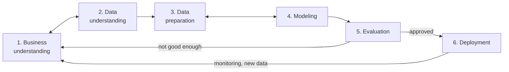

# 01 · The CRISP-DM workflow in this project

**CRISP-DM** (Cross-Industry Standard Process for Data Mining) is the most widely used framework for organizing data-science projects. It has six phases. The process is iterative and the sequence of the phases is not strcit and the project can move back and forth as needed..

## Phase by phase

| # | Phase | Description | Section of the final notebook |
|---|---|---|---|
| 1 | **Business understanding** | Define the goal. Specify success criteria. Identify the risks. | Problem Statement |
| 2 | **Data understanding** | Assess data quality. Describe data. Explore data. Recognize patterns. | Data Collection; Data Preprocessing, step 1 |
| 3 | **Data preparation** | Data selection. Cleanse Data. Chronological split. Feature engineering. | Data Preprocessing |
| 4 | **Modeling** | Select Models. Design Models. Build Models. Train Models. | Methodology; Model Fitting and Validation |
| 5 | **Evaluation** | Asses the model metrics compared with baselines. Verify success criteria is meet. | Model Evaluation; Issues / Improvements |
| 6 | **Deployment** | Plan deployment. Setup Model Monitoring. Define thresholds to retrain Model when it starts drifting. | Saved models and historical deployment demonstration |

**Design principle:** one notebook holds the explanation and all the code, so it runs with no other project code. The same functions are used for evaluation and for the deployment demonstration, so the logic that was evaluated is exactly the logic that gets demonstrated.

## Suggested project reading order.
1. Read this document.
2. Run `notebooks/Team7_Deep_Learning_Final_Project.ipynb` from top to bottom.
3. Read `docs/02` (with Data Preprocessing), `docs/03` (with Methodology and Model Fitting), `docs/04` (with Model Evaluation) and `docs/05` (with the deployment demonstration).
4. Evaluate results, research possible improvement ideas and run a new CRISP-DM iteration.

## References
IBM. IBM SPSS Modeler CRISP-DM Guide. Version 18, Release 0, Modification 0. IBM Corporation, 2016.

Wikipedia contributors, "Cross-industry standard process for data mining," Wikipedia, The Free Encyclopedia, https://en.wikipedia.org/w/index.php?title=Cross-industry_standard_process_for_data_mining&oldid=1376004303 (accessed September 28, 2026).
