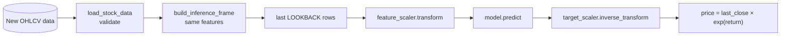

# 05 · Deployment and operations

Deployment is the last CRISP-DM phase: putting the model where people or systems can use it on **new data**, and keeping it healthy over time.

---

## 1. The artifact folder

Each training run writes a self-contained folder in `artifacts/`:

```
artifacts/lstm_close_volume/
├── model.h5                  # network architecture + trained weights
├── feature_scaler.joblib     # StandardScaler fitted on TRAINING features
├── target_scaler.joblib      # StandardScaler fitted on TRAINING targets
├── metadata.json             # features, lookback, target mode, dates, settings
├── history.json              # per-epoch loss (learning curves)
└── predictions_test.csv      # test-set predictions (written by evaluation)
```

**Note**: a model alone cannot make correct predictions. It expects inputs that were:
1. built with the **same features** (`feature_columns` in the metadata),
2. using the **same lookback** (`lookback`),
3. scaled with the **same fitted scalers**,

The model's output must be converted back using the same target mode and target scaler. Saving all of these together prevents a production bug where inference preprocessing differs slightly from training.

> **Format note:** TensorFlow 2.10 saves `.h5` (HDF5) or SavedModel folders. The newer `.keras` format needs TF ≥ 2.12.

---

## 2. The inference pipeline (`src/predict.py`)



`predict_next_day()` is the **single source of truth**. The notebook calls it, so what was tested is what runs.

---

## 3. How to use the model

### Python
```python
from src.predict import predict_next_day
result = predict_next_day("artifacts/lstm_close")
print(result["predicted_close"])
```

---

## 4. REST API

A web API lets other applications request predictions over HTTP. A minimal FastAPI version (not included in the repo; install `fastapi` and `uvicorn` first):

```python
# api.py
from fastapi import FastAPI
from src.predict import load_artifacts, predict_next_day

app = FastAPI(title="Next-day close API")
ARTIFACTS = load_artifacts("artifacts/lstm_close")   # load once at startup

@app.get("/health")
def health():
    return {"status": "ok", "model": ARTIFACTS["metadata"]["run_name"]}

@app.get("/predict")
def predict():
    return predict_next_day(ARTIFACTS)
```
Run with `uvicorn api:app --port 8000`, then open `http://localhost:8000/docs`.

### Containerizing with Docker
```dockerfile
FROM python:3.9-slim
WORKDIR /app
COPY requirements.txt .
RUN pip install --no-cache-dir -r requirements.txt fastapi uvicorn
COPY config.py ./
COPY src/ src/
COPY artifacts/lstm_close/ artifacts/lstm_close/
COPY data/ data/
CMD ["uvicorn", "api:app", "--host", "0.0.0.0", "--port", "8000"]
```
A container bundles the exact library versions, so the model behaves the same on any machine or cloud.

---

## 5. Monitoring: models degrade silently

Markets change, and a model trained on 2010-2021 will gradually drift away from reality. Monitor three things:

| What | How | Alert when |
|---|---|---|
| **Data quality** | The loader's validation (nulls, swapped columns, non-positive prices, duplicate dates) | Any validation error, or a missing trading day |
| **Data drift** | Compare recent feature distributions (return volatility, log volume) with the training distribution: mean/std shift, Population Stability Index, or the Kolmogorov-Smirnov test | The feature distribution moves several std away from training |
| **Performance** | Log every prediction; the next day, compute the error. Track a rolling 20-day MAE for **model and naive baseline** | The model's rolling MAE exceeds the naive MAE for a sustained period |

Example monitoring log:

| date | predicted | actual | abs error | naive abs error |
|---|---|---|---|---|
| 2026-09-09 | 316.59 | … | … | … |

---

## 6. Retraining strategy

| Strategy | Description | Pros / cons |
|---|---|---|
| **Scheduled** | Retrain every month or quarter with all data up to that date | Simple and predictable; may retrain when not needed |
| **Triggered** | Retrain when monitoring detects drift or degraded error | Efficient; needs reliable monitoring |
| **Rolling window** | Train only on the last N years | Adapts to new regimes; less data |

**Retraining workflow:** load new data → run the same training pipeline → evaluate on the most recent held-out period → compare with the **current production model** and the baselines → promote only if better → keep the old artifact folder for rollback.

---

## 7. Versioning and reproducibility

- **Code:** git (tag the commit used for each deployed model).
- **Data:** keep a snapshot or hash of the training data.
- **Models:** one artifact folder per run with `metadata.json` (`trained_at`, TF version, data range).
- **Environment:** `requirements.txt` with pinned versions, or a Docker image.

---

## 8. Responsible use

- Show the **uncertainty and limitations**. A single number looks more certain than it is.
- Show the **baseline comparison** next to the prediction.
- Add a clear **"not financial advice"** disclaimer.
- Record which model version produced each prediction (audit trail).

---

## 9. Deployment checklist

- [ ] Artifact folder contains the model, both scalers and the metadata
- [ ] Inference uses the same `predict_next_day()` function that was tested
- [ ] Input data is validated before predicting
- [ ] Predictions are logged with the model version
- [ ] Monitoring of error vs the naive baseline is in place
- [ ] Retraining and rollback procedure is documented
- [ ] Disclaimer is visible to users
